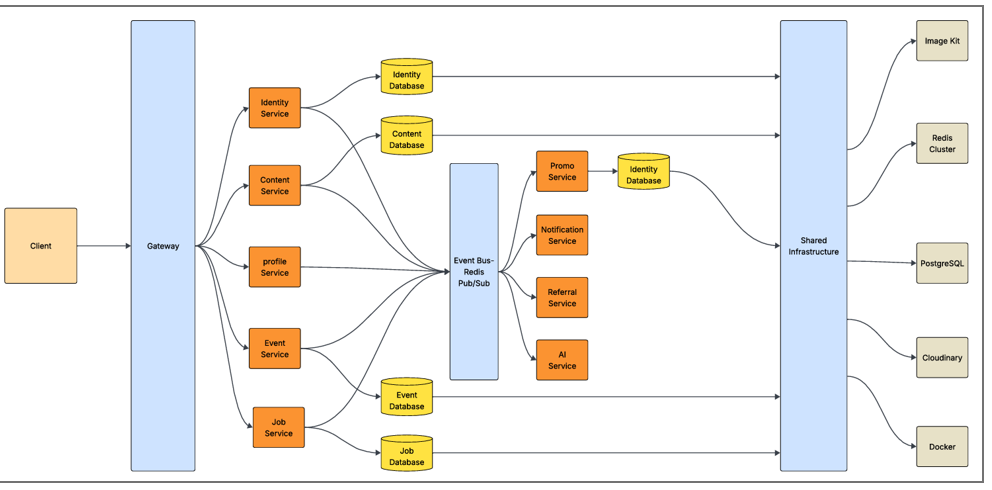
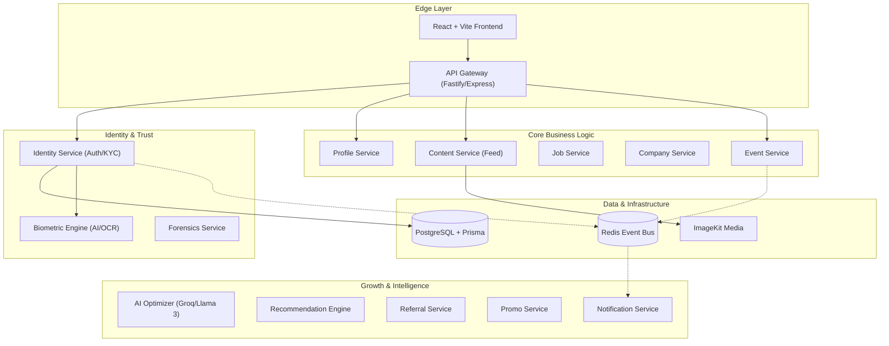

# HireX

HireX is a premium, verified professional networking and event management ecosystem. It bridges the "trust gap" in professional interactions through identity verification, cryptographic proof of attendance, and automated financial escrows. Built with a modular microservices architecture, it provides a high-scale, secure environment for professionals and businesses.

## 🌟 Key Features

- **Zero-Trust Identity**: Mandatory identity verification (KYC) & (KYB) using AI-driven biometrics.
- **Microservices Architecture**: 13+ specialized services for high scalability and fault tolerance.
- **Event Trust Engine**: Automated financial escrows and cryptographic proof of attendance for professional events.
- **Smart Professional Hub**: AI-optimized profiles, professional job matching, and referral-based networking.
- **Business Verification 2.0**: Multi-stage verification that validates both the company's legal status and the identity of the user claiming representative rights.
- **Real-time Ecosystem**: Distributed event bus for instant notifications and updates across services.
- **Premium UX/UI**: Minimalist, high-end professional design using React 18 and Tailwind CSS.

---

## 🏗️ System Architecture



The ecosystem follows a sophisticated microservices architecture, where each domain is isolated to ensure maximum security and performance.



---

## 📂 Project Structure & Folders

### 🎨 `frontend/`
The client-side application built with **React 18** and **Vite**.
- `src/components/`: Reusable UI components (Modals, Feed Cards, Skeletons).
- `src/pages/`: Main application views (Dashboard, Network, Events, Profile).
- `src/services/`: API client abstractions for communicating with the Gateway.
- `src/utils/`: Helper functions and configuration (ImageKit integration, Formatters).

### ⚙️ `services/`
A collection of 13 independent microservices.
- **`gateway`**: Central entry point. Handles request routing, authentication proxying, and global middleware.
- **`identity-svc`**: Manages user registration, login (JWT), RBAC, and KYC state.
- **`profile-svc`**: Handles professional profiles, resumes, and personal details.
- **`content-svc`**: Manages the social feed, posts, and interaction logic.
- **`event-svc`**: Core logic for event creation, ticketing, and escrow management.
- **`job-svc`**: Job board functionalities and application tracking.
- **`company-svc`**: Handles business verification and rep management. Includes a two-stage verification flow: once a company is legally verified, the claiming user undergoes identity verification to ensure they are an authorized representative.
- **`referral-svc`**: Tracking system for network growth and wallet rewards.
- **`ai-svc`**: High-performance AI integration using Groq for profile optimization.
- **`notification-svc`**: Real-time WebSocket/Email notification system.
- **`promo-svc`**: Management of sponsored content and smart advertisements.
- **`recommendation-svc`**: Discovery algorithms for people and jobs.

### 🧩 `shared/`
Common logic shared across multiple backend services to maintain DRY principles.
- `eventBus.js`: Wrapper for Redis-based pub/sub communication.
- `logger.js`: Centralized logging configuration.
- `redis.js`: Redis client connection management.

---

## 🛠️ Technology Stack

## 🛠️ Technology Stack (Rationale & Usage)

### **Frontend (The User Experience)**
| Technology | Why We Use It | Where It's Used |
| :--- | :--- | :--- |
| **React 18** | Industry-standard for building dynamic, high-performance SPAs with a component-driven architecture. | Entire client-side UI and state management. |
| **Vite** | Blazing fast build tool and dev server, providing a superior developer experience over Webpack. | Project bundling and development environment. |
| **Tailwind CSS** | Utility-first styling for rapid UI development and consistent professional aesthetics. | All visual styling and responsive layouts. |
| **React Router 6** | Declarative routing for seamless navigation between pages without full reloads. | Multi-page navigation (Home, Profile, Events, etc.). |
| **Lucide React** | Clean, consistent, and lightweight icon library for professional UI symbols. | Dashboard icons, buttons, and status indicators. |
| **Axios** | Robust HTTP client for handling API requests with interceptors for auth tokens. | Communication between Frontend and Gateway. |
| **Didit Protocol** | Secure, decentralized identity verification for professional-grade trust. | KYC flow and user verification status. |
| **ImageKit SDK** | Real-time image optimization and CDN delivery for fast media loading. | Post attachments, profile pictures, and event banners. |

### **Backend & Services (The Engine)**
| Technology | Why We Use It | Where It's Used |
| :--- | :--- | :--- |
| **Node.js (ESM)** | High-concurrency runtime that allows sharing logic easily between services. | Base for all 13 microservices. |
| **Fastify** | Extremely low-overhead web framework focused on maximum performance. | High-traffic services like `gateway` and `content-svc`. |
| **Prisma ORM** | Type-safe database client that prevents runtime errors and simplifies complex queries. | Every service that interacts with PostgreSQL. |
| **Redis** | High-speed in-memory data store for real-time messaging and caching. | `shared/eventBus.js` and notification systems. |
| **Zod** | Schema validation to ensure API inputs are safe and correctly formatted. | All API route handlers and data ingestion points. |
| **JWT** | Stateless authentication for secure communication in a distributed system. | `identity-svc` and `gateway` for session management. |

### **Intelligence & Security (The Trust Layer)**
| Technology | Why We Use It | Where It's Used |
| :--- | :--- | :--- |
| **Groq / Llama 3** | Cutting-edge LLM for lightning-fast professional content optimization. | `ai-svc` for profile and post enhancement. |
| **Tesseract.js** | Client/Server-side OCR for extracting data from identity documents. | `identity-svc` during the KYC/Verification process. |
| **OpenCV** | Computer vision for liveness detection and biometric matching. | `forensics-svc` for preventing identity fraud. |
| **RBAC** | Granular access control to ensure users only access authorized features. | Global security layer across all service controllers. |

### **Data & Infrastructure**
| Technology | Why We Use It | Where It's Used |
| :--- | :--- | :--- |
| **PostgreSQL** | Reliable, ACID-compliant relational database for structured user and event data. | Primary data persistence for core services. |
| **Pinecone** | Vector database for similarity searches and AI-driven recommendations. | `recommendation-svc` for finding relevant jobs/people. |
| **ImageKit.io** | Cloud-based media management with automated cropping and delivery. | Global media asset storage and optimization. |

---

## 🔌 APIs Integrated (Detailed Data & Compliance)

### **🛡️ Didit API (Identity Verification)**
*   **Official Website**: [didit.me](https://didit.me)
*   **Legal Documentation**: [Google Drive Folder](https://drive.google.com/drive/folders/1u4UrTVy6yL0Few_egAvGy42Pg1AqyWV2?usp=sharing)
*   **Data Fetched (Inputs)**: User's official identity documents (Aadhaar, PAN, Passport), real-time camera feed for liveness.
*   **Data Returned (Outputs)**: Verification status (Success/Fail), extracted PII (Full Name, DOB, Document ID), Liveness Score, and Biometric Hash.
*   **Paid/Premium Features**: 
    *   **AML/Sanction Screening**: Checks users against global financial crime watchlists.
    *   **Advanced Proof of Personhood**: Decentralized identity (DiD) generation.
*   **Security & Standards**: 
    *   **ISO 27001 / 27017 / 27018** (Information Security & Cloud Privacy).
    *   **GDPR Compliant** (Data processed in EU).
    *   **ISO 30107-3 (iBeta Level 1)** for presentation attack detection.

### **🏢 OpenCorporates API (Global Business Verification)**
*   **Official Website**: [opencorporates.com](https://opencorporates.com)
*   **Legal Documentation**: [Google Drive Folder](https://drive.google.com/drive/folders/1u6PzRyrh_EfXAzCaNdbCfVMvSzNGdhtE?usp=sharing)
*   **Data Fetched (Inputs)**: Company Name, Registration Number, or Jurisdiction.
*   **Data Returned (Outputs)**: Incorporation date, current status (Active/Dissolved), registered address, and company type.
*   **Paid/Premium Features**: 
    *   **Director Network**: Returns full lists of current and former officers/directors.
    *   **Corporate Grouping**: Shows parent companies and subsidiaries.
    *   **Filing History**: Metadata on historical legal filings.
*   **Security & Standards**: 
    *   **Data Provenance**: All data is sourced directly from official government registries.
    *   **Used by Regulators**: Trusted by the World Bank, FBI, and global financial institutions for KYC/KYB.

### **🏛️ Companies House API (UK Government Registry)**
*   **Official Website**: [developer.company-information.service.gov.uk](https://developer.company-information.service.gov.uk)
*   **Legal Documentation**: [Google Drive Folder](https://drive.google.com/drive/folders/1GqF5Qt1k4JRe_WSVWH8ILyFYoOrFK8Ni?usp=sharing)
*   **Data Fetched (Inputs)**: UK Company Number or Officer Name.
*   **Data Returned (Outputs)**: Confirmation of legal existence, PSC (Persons with Significant Control) data, and basic account status.
*   **Paid/Premium Features**: Access to high-resolution document images (PDFs of annual accounts and mortgage charges).
*   **Security & Standards**: 
    *   **UK Government Cyber Essentials**: Adheres to Cabinet Office security standards.
    *   **OAuth 2.0 & TLS 1.2+** encryption for all data transfers.

### **🚀 Groq API (High-Speed AI Engine)**
*   **Official Website**: [groq.com](https://groq.com)
*   **Data Fetched (Inputs)**: User profiles, resumes, raw post content, or chatbot queries.
*   **Data Returned (Outputs)**: Optimized professional text, summarized resumes, sentiment analysis, and structured AI responses.
*   **Paid/Premium Features**: 
    *   **Higher Rate Limits**: For massive scale concurrent AI processing.
    *   **Enterprise SLA**: Guaranteed uptime and dedicated support.
    *   **Custom Models**: Ability to use fine-tuned weights.
*   **Security & Standards**: 
    *   **SOC 2 Type II** Certified (Annual independent audits).
    *   **HIPAA Compliant** (Safe for processing health-related professional data).
    *   **Zero Data Retention (ZDR)** options available for high-privacy tiers.

---

## 🚦 Getting Started

### Prerequisites
- Node.js (v18+)
- PostgreSQL instance
- Redis server
- ImageKit.io credentials

### 1. Global Setup
```bash
git clone https://github.com/hirexitsocial/Quantum-Paradox.git
cd Quantum-Paradox
```

### 2. Service Configuration
Each service in `/services` contains its own `.env` file. You must configure these with your database URLs and API keys.

### 3. Initialize Identity Service (Core)
```bash
cd services/identity-svc
npm install
npx prisma generate
npx prisma db push
npm run dev
```

### 4. Launch the Gateway
```bash
cd services/gateway
npm install
npm run dev
```

### 5. Start the Frontend
```bash
cd frontend
npm install
npm run dev
```

---

## ⚖️ License
Distributed under the MIT License. See `LICENSE` for more information.

---
*Built with precision for the modern professional.*
